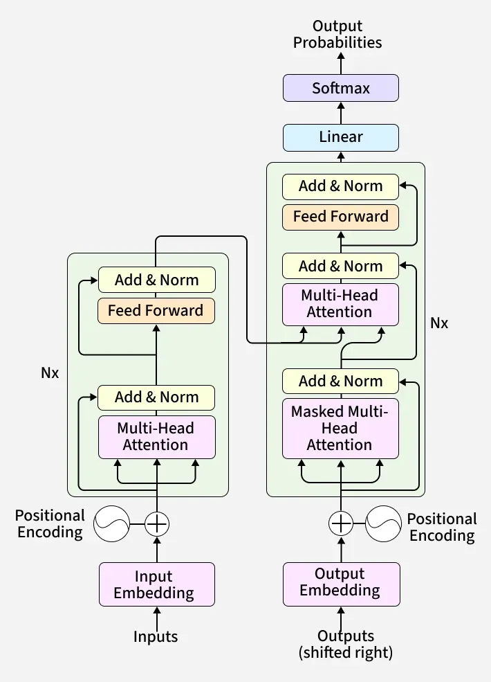
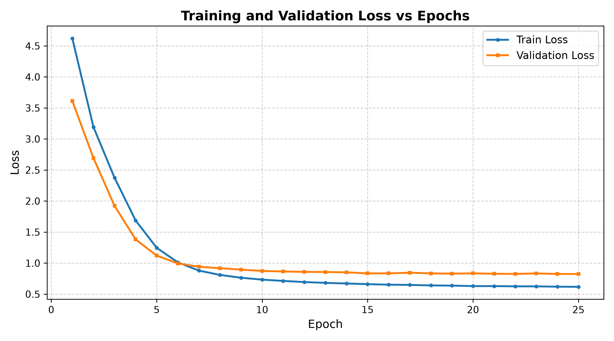
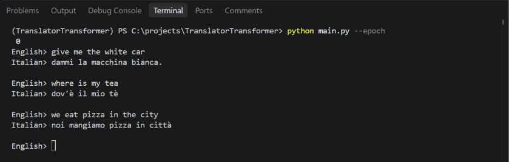

# Neural Machine Translation Using a Transformer Encoder-Decoder Architecture: An English-to-Italian Study

## Abstract and Overview

This repository provides an end-to-end implementation of an attentional sequence-to-sequence neural machine translation framework designed to translate natural language sentences from English into Italian. Grounded in the architectural principles established by Vaswani et al. (2017), the network relies entirely on multi-head attention mechanisms, eschewing recurrence and convolutions. The primary objective of this project is to investigate the learning dynamics, syntactic acquisition, and representational capacity of a compact Transformer trained on a highly constrained parallel corpus under strict computational bounds.

## Architectural Formulation

The implemented system adopts the canonical Transformer encoder-decoder topology, illustrated below:



### Encoder Architecture

The encoder is composed of identical stacked layers designed to map a source sentence of English word tokens into continuous contextual representations.

1. Token and Positional Embeddings: The input token sequence is projected into an embedding space of dimension d_model. Because the network contains no innate recurrence, learned positional embeddings are added element-wise to provide spatial coordinate information across time steps.
2. Multi-Head Self-Attention: Each layer incorporates a multi-head self-attention module with four parallel attention heads. Scaled dot-product attention computes interactions across all input positions. A boolean source padding mask suppresses all attention scores directed toward padding tokens, ensuring they do not distort context representations.
3. Position-Wise Feed-Forward Network: The output of self-attention is processed through a two-layer feed-forward network with an intermediate expansion to dimension d_ff, applying a Rectified Linear Unit activation.
4. Residual Connections and Normalization: Every sub-layer is wrapped by a residual connection followed by Layer Normalization, preventing vanishing gradients and stabilizing parameter updates.

### Decoder Architecture

The decoder autoregressively generates the Italian translation given the encoder contextual representations and previously emitted tokens.

1. Output Embeddings and Learned Positions: Target tokens are projected to the shared model dimension and combined with learned target positional embeddings.
2. Masked Causal Self-Attention: To prevent the model from attending to future positions during training, the decoder employs an upper-triangular boolean causal mask alongside the target padding mask. This guarantees that prediction for position t depends solely on positions prior to t.
3. Encoder-Decoder Cross-Attention: In this block, queries are generated from previous decoder layers, whereas keys and values originate from the final encoder output. This mechanism dynamically weights the salient semantic aspects of the source sentence relevant to the next Italian token.
4. Linear Projection and Generator: A final linear layer maps the output vectors into the discrete Italian vocabulary space to produce unnormalized log-probabilities.

## Optimization Methodology and Training Regimen

The training workflow incorporates several modern deep learning techniques to maximize stability and generalization:

1. Word-Level Lexical Processing: Source and target sequences are tokenized using Unicode regular expressions, preserving distinct punctuation marks as autonomous lexical entities. Special reserved tokens designate padding, unknown words, sequence start, and sequence termination.
2. Teacher Forcing: Training is conducted in parallel using teacher forcing, wherein the shifted target sequence is supplied to the decoder as gold-standard context.
3. Regularized Objective Function: Optimization minimizes Cross-Entropy loss augmented by label smoothing. Label smoothing mitigates model overconfidence and prevents early saturation of probability outputs over the small training sample.
4. Parameter Optimization: Parameters are updated via the Adam optimizer with decoupled weight decay to enforce L2 regularization on network weights.
5. Gradient Norm Clipping: To counteract potential gradient explosion during backpropagation through time, gradients are clipped at a maximum global norm threshold of 1.0.
6. Dynamic Learning Rate Scheduling: A ReduceLROnPlateau scheduler monitors validation loss, reducing the learning rate by a factor of 0.5 whenever validation improvements plateau across successive evaluation cycles.
7. Reproducibility: Deterministic training conditions are established by synchronizing pseudo-random number seeds across Python and PyTorch runtime engines.

## Empirical Convergence and Quantitative Results

Model convergence was monitored across 25 training epochs by evaluating both training and validation loss at the end of each cycle. The optimization trajectory is documented below:



Throughout optimization, the loss decreased smoothly across both splits. The best checkpoint achieved during training yielded the following evaluation metrics:

Epoch 025/25 | train_loss=0.6168 | val_loss=0.8242 | best_val=0.8242 | lr=3.00e-04 | new best

The validation loss decreased steadily from initial values exceeding 3.90 down to an optimal loss of 0.8242. The close tracking between training loss (0.6168) and validation loss confirms that regularization successfully averted catastrophic overfitting despite the limited corpus size.

## Interactive Inference and Qualitative Evaluation

During inference, translation is executed via greedy autoregressive decoding. The decoder begins with the start-of-sequence token and recursively generates tokens one by one until the model emits the end-of-sequence token or reaches the sequence length ceiling.

The screenshot below illustrates an interactive testing session conducted through the command-line interface on sentences not present in the original dataset:



The qualitative evaluations demonstrate prompt inference latency, predictable token mapping, and stable greedy search execution across interactive prompts.

## Critical Analysis of Model Limitations

While the architecture exemplifies the theoretical power of sequence-to-sequence Transformers, practical operational capability is constrained by several specific technical boundaries:

1. Sentence Length Constraint: The model architecture enforces a strict maximum sequence length ceiling of six words. Longer sentences cannot be encoded without truncation, which precludes translating compound clauses, dependent structures, or multi-sentence paragraphs.
2. Generation Errors and Semantic Drifts: Given the compact parameter scale and limited data density, the model remains susceptible to translation errors, grammatical hallucinations, and improper lexical substitutions when confronted with unfamiliar syntactic patterns.
3. Severe Vocabulary Sparsity: The vocabulary is closed and small, comprising exactly 972 English tokens and 1242 Italian tokens. Any lexical item outside this narrow dictionary is mapped to the unknown token, causing degradation in sentence coherence.
4. Minimal Training Corpus: The dataset represents an extraordinarily small sample of parallel text compared to industrial translation corpora. Consequently, the network has limited exposure to polysemy, regional expressions, varied registers, and rare syntactic structures.

## Syntactic Acquisition and Grammatical Generalization

Despite the severe dataset restrictions and lexical bottleneck, empirical inspection reveals that the model succeeded in learning genuine grammatical structures from the parallel corpus rather than merely memorizing pairs:

1. Structural Word Order Alignment: The attention matrices successfully coordinate English Subject-Verb-Object orders with corresponding Italian structures, correctly reordering elements where necessary.
2. Inflectional Agreement: In generated outputs, Italian nouns, adjectives, and verbs frequently demonstrate correct gender, number, and person agreement. For example, singular masculine subjects trigger singular masculine verb inflections and adjective endings.
3. Grammatical Cohesion: In short interrogative and declarative sentences within the supported length, the model reliably captures structural punctuation, interrogative words, and functional prepositions.

These qualitative observations demonstrate that the Transformer self-attention and cross-attention blocks are capable of abstracting essential grammatical relationships even under extreme data and sequence-length scarcity.

## Execution and Usage Guide

The repository provides dedicated scripts for environment configuration, model training, standalone inference, and vocabulary extraction.

### 1. Environment Configuration

Install the required dependencies, including PyTorch and Matplotlib:

```bash
pip install -r requirements.txt
```

### 2. Model Training

To train the Transformer encoder-decoder network using default hyperparameters on translation_dataset.csv:

```bash
python main.py
```

During execution, training and validation loss metrics are logged at every epoch. Upon completion, optimal model parameters are saved to checkpoints/best_model.pt, token vocabularies are preserved in checkpoints/, and the convergence plot is generated at checkpoints/loss_curve.png.

Commonly utilized configuration options:

```bash
# Train for 25 epochs with a custom batch size
python main.py --epochs 25 --batch-size 16

# Force computation on CPU
python main.py --cpu

# Headless training without displaying the graphical plot window
python main.py --no-plot --skip-interactive
```

### 3. Model Inference and Evaluation

The dedicated inference module enables interactive sequence generation or one-shot command-line translation:

```bash
# Launch interactive translation using models/model_v1.pt
python inference.py

# Evaluate a specific model checkpoint
python inference.py model_v1.pt

# Translate a single English sentence and exit immediately
python inference.py --sentence "Hello, how are you?"
```

### 4. Vocabulary Extraction

To export token vocabularies from checkpoints/ into text files with one word per line in the project root:

```bash
python vocab.py
```
